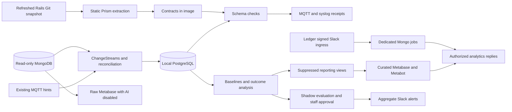

# Ledger anomaly analytics

The optional analytics stack reads Makerspace MongoDB and consumes dedicated jobs
from Ledger's signed Slack ingress. PostgreSQL stores observations, checkpoints,
baselines, model generations, findings and delivery receipts. It can run on a
different host from Rails, Ledger, MQTT or vLLM. Analytics never changes source
records, subscriptions, access permissions or disciplinary decisions.

Start with [build and schema refresh](ANOMALY_BUILD.md),
[Slack access](ANOMALY_SLACK.md), and [Metabase setup](ANOMALY_METABASE.md).
`compose.anomaly.yaml` defines `ledger-anomaly`, `anomaly-postgres`,
`metabase-anomaly` and `metabase-raw`. The Metabase instances share a built fork
image but have separate accounts, application databases and inference settings.

## Data boundaries



Source privileges are exact collection `find` and `changeStream` grants. Source
writes are prohibited. PostgreSQL owns analytics state; `LEDGER_URI` supplies the
existing durable queue. No new owned Mongo collection is introduced. Generated
source-role examples cover discovered collections rather than a fixed count.

Streams open before backfill. Sanitized captures and resume tokens commit in the
same PostgreSQL transaction; event processing and downstream state are also
atomic. Replays are deduplicated. MQTT requests reconciliation without creating
outcome transitions or advancing stream checkpoints. Snapshot watermarks prevent
older scan data from replacing newer stream observations. Expired tokens record
coverage gaps. `updateLookup` is current state, so unprovable event histories
remain uncertain.

Unchanged reconciliation snapshots reuse a persistent content receipt, including
after processed-event retention. Scan generations track missing documents only;
changed content, accepted schema changes and changed reference targets trigger
new validation. Idle stream tokens update checkpoints without retained event rows.

The source contract is parsed using [Ruby Prism](https://docs.ruby-lang.org/en/3.4/Prism.html).
Mongo deployment must support [ChangeStreams](https://www.mongodb.com/docs/manual/changestreams/);
size its connection pool above the number of simultaneous collection streams.

Structural validation precedes the independent analytics projection. Credentials,
access identifiers, internal notes, ticket contents and raw billing/webhook data
do not enter local events, notifications or inference. Card joins use a persistent
keyed digest. Payment evidence retains approved dates and derived predicates,
not transaction IDs or amounts. Unknown field names are digested in findings.
Schema discovery does not expand this projection.

## Analysis and evidence

The primary reference, `reference-documents/5-data-anomalies-and-anomaly-detection-practices-for-enterprise-data-t.md`,
distinguishes point, contextual and collective anomalies, along with insertion,
update and deletion integrity problems. This implementation applies them as follows:

| Reference principle | Implementation |
| --- | --- |
| Point anomalies | Type/enum/required checks, median/MAD and empirical quantiles |
| Contextual anomalies | Member history, weekday/hour patterns, season and coverage completeness |
| Collective anomalies | Distribution indicators and CPU Isolation Forest shadow findings |
| Insertion integrity | Identifier, unique-index and reference validation |
| Update integrity | Rechecked references, household expiry conflicts and schema drift |
| Deletion integrity | Delayed dependent-reference checks and reconciliation |

`Advanced Techniques for Anomaly Detection`, `Data Analytics using Python` and
`Predictive Analytics for the Modern Enterprise` inform contextual comparisons,
regularization and evaluation. They motivate hypotheses, not claims that a
pattern predicts this makerspace's outcomes.

Features use 7-, 28- and 90-day windows. Timestamp units normalize to UTC; cadence
uses `ANOMALY_TIMEZONE` (default `America/New_York`). Repeated scans collapse into
visits. Historical card ownership remains uncertain without dated mapping
evidence. Zero visits is usable only when monitoring coverage is complete.
Observations are scored before learning. Invalid records and unresolved anomalies
are excluded from normal baselines; stable comparison history exposes drift.

| Outcome | Evidence rule |
| --- | --- |
| Cancellation | Dated explicit event, separated into voluntary, payment failure and unknown; rental cancellation excluded |
| Lapse | Verified paid coverage remains unrenewed for the 30-day grace period with complete observation |
| Revocation | Dated transition into revoked; undated current status cannot supply a predictive label |
| Sustained membership | Verified paid days exceed 75% of any rolling 24-calendar-month window; overlaps merge and returning members count |

Paid coverage requires positive payment corroborated by a dated entitlement
extension. Current subscription flags or expiry cannot reconstruct past payment.
Direct payers, household payers/beneficiaries and earned/free membership remain
distinct. Sufficient positive paid evidence can establish qualification despite
missing earlier history; missing coverage cannot prove nonqualification. Current
membership is independent of historical qualification. Positive-cohort geography
and visit patterns are descriptive until a trustworthy comparison exists.

Regularized logistic models use 30-/90-day horizons, time-purged holdouts and
household-disjoint groups. Publication needs at least 50 trustworthy positive
outcomes, a usable temporal holdout, calibration, precision/recall and PR-AUC
checks against simple baselines. Revocation findings remain aggregate associations;
individual revocation probabilities are not shown. Historical backfill provides
descriptive patterns; predictive gates may need months of prospective evidence.

Detailed feature/outcome history defaults to five years, and processed captures
to 90 days. Open findings, pending deliveries, baselines, model generations and
positive qualification proof survive pruning/rebuilds. Only explicitly granted
`reporting` views are available to curated Metabase; PostgreSQL working state is
private to the engine.

Outcome refresh replaces derived labels with the current evidence set, removing
labels invalidated by corrections or deletions. Archived paid qualifications
survive history compaction but are revoked by a known invoice deletion or refund.

## Detectors and delivery

AI reuses Ledger's vLLM endpoint and receives canonical questions and suppressed
aggregates, never raw Slack text or member records. The versioned `anomaly_explain`
and `anomaly_propose` prompts share Matrix 50. Proposals use a closed declarative
specification: supported feature, comparison, window, threshold, evidence minimum,
reference, confounders and falsification criterion. Python validates every field.

In a verified admin/board DM:

```text
/ledger-anomaly detectors propose
/ledger-anomaly detectors list
/ledger-anomaly detectors review <exact revision>
/ledger-anomaly detectors approve <exact revision>
/ledger-anomaly detectors disable <exact revision>
/ledger-anomaly detectors resolve <finding ID>
/ledger-anomaly schema review
/ledger-anomaly schema review <collection>
/ledger-anomaly schema approve <exact revision>
```

Detector approval requires a passing backtest, seven days and at least 50 shadow
observations within its alert-rate budget. Editing a proposal creates a new
revision. Alerts additionally require `ANOMALY_SLACK_ALERT_MODE=active`; the
default is `shadow`. Cohorts smaller than five and complementary breakdowns are
suppressed in application code.

Confirmed schema findings use non-retained MQTT `ledger/v1/anomalies`, QoS 1, and
RFC 5424 syslog (TLS/6514 by default). Independent receipts retry each sink.
Consumers deduplicate stable event IDs: a crash between sending and saving the
receipt can repeat delivery. UDP syslog has no remote acknowledgment. Behavioral
Slack alerts apply a 24-hour detector/entity cooldown and ten-message hourly
budget including an overflow summary.

Recognized analytics questions and `/ledger-anomaly ask <question>` select
supported reports. Staff may mention a member in their own DM for Python-rendered
evidence. Native Metabot enriches staff DM exploration; aggregate explanations
use the shared narrator. Conversations are isolated by workspace, Metabase origin,
requester, destination, thread and permission class. Every delivery/upload
rechecks access. Inference/Metabase outages preserve factual text; chart retries
reuse the text receipt and do not claim an attachment was delivered.

## Separate-host operation

Install Ledger and the configured Metabase source checkout on the analytics build
host. No files, GPU, volume or Docker network need be shared with running Ledger.
The build host fetches Rails into a managed cache before shutdown. Existing Slack
ingress stays on the Ledger host. On analytics, configure routable private endpoints:

```dotenv
MLAB_URI=<read-only replica-set URI>
MLAB_DATABASE=<optional override>
LEDGER_URI=<existing durable queue URI>
LEDGER_DATABASE=<optional override>
ANOMALY_LLM_BASE_URL=http://<inference-host>:8000/v1
MQTT_HOST=<broker-host>
ANOMALY_MQTT_CLIENT_ID=ledger-anomaly-<deployment>
ANOMALY_SYSLOG_HOST=<collector-host>
SLACK_CHANNEL_ANOMALY=ledger-audit
ANOMALY_SLACK_ALERT_MODE=shadow
```

Supply distinct database/Metabase credentials from `.env.example`. Set
`ANOMALY_ENABLED=true` on the existing **Ledger ingress/worker deployment** too,
so requests reach the dedicated queue. Both hosts need the same Slack bot,
workspace and anomaly-channel configuration. Analytics needs no inbound Slack
endpoint. Set `ANOMALY_METABASE_PUBLIC_URL` for authenticated dashboard links.

Run `COMPOSE_FILE=compose.anomaly.yaml bash scripts/rebuild.sh`; combined deployment
uses `COMPOSE_FILE=compose.yaml:compose.anomaly.yaml`. See the build guide for
immutable Rails rollback and source permission preflight. Native Metabot requires
at least 16,384 context tokens; validate GB10 memory/concurrency before activation.

## Rollout, recovery and verification

1. Refresh/extract Rails, inspect provenance and generated Mongo role changes, and
   pass source permission preflight before replacing the running deployment.
2. Start in shadow mode. Inspect historical evidence, stream gaps and staged
   schemas against the actual deployed Rails revision before approval.
3. Bootstrap separate Metabase instances. Verify the curated reader cannot read
   state tables/MongoDB; test native chat, chart access and dependency outages.
4. Observe catch-up and shadow results, then approve exact tested revisions.
   Insufficient labels must remain insufficient rather than guessed probabilities.
5. Test backup/restore, restart replay, queued permission revocation and independent
   MQTT/syslog failures before production activation.

Back up all three PostgreSQL application databases, role definitions, Metabase encryption keys,
deployment configuration and image/schema provenance. Use restricted files
(`umask 077`), `pg_dump -Fc` for each database and `pg_dumpall --globals-only` for
roles; retain secrets in the normal secret backup store. PostgreSQL also contains
the HMAC join key, so a partial state restore is not valid identity recovery.

Restore into an isolated volume with outbound notifications disabled. Verify
checkpoint, baseline/model revisions, pending receipts and dashboard access.
Expired source resume history should create a gap and reconciliation. Never use
`down --volumes` for upgrades or rollback. Restore matching image/configuration
when reverting feature semantics and retain newer model generations for review.

```sh
python -m pip install -e '.[test,anomaly]'
python -m ledger.prompt_matrix
python -m ledger.prompt_library
python -m pytest
```

Real PostgreSQL transaction/reconnect tests additionally use
`ANOMALY_TEST_DATABASE_URL`, with a disposable database named `ledger_anomaly_test_*`.
Build tests use local Git fixtures and mocked Docker. Run native Metabase
API/render tests in that fork's backend environment. Docker builds, private Git
authentication, database restore, native PNG output, GB10 and live integrations
remain deployment checks separate from Python/static validation.


Security analytics adds a separate privacy-safe event projection, indexed PostgreSQL history, 15-second exact-rule evaluation, staff-only DM alerts and suppressed aggregate reports. See [security monitoring and rollout](ANOMALY_SECURITY.md). Membership analytics retains its existing schedule and models.
